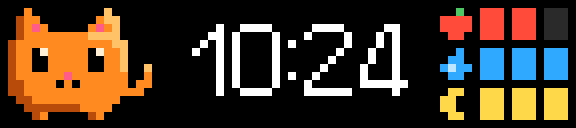
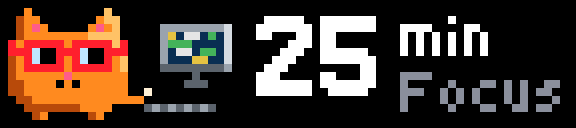
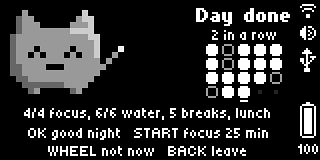

# Paws

A desk cat for the [BUSY Bar](https://busy.bar) that does well when you treat yourself well. It works beside you
during a focus session, asks for a break when you skip them, asks for lunch and water, and sleeps after your end
of day.







The front display, 72x16, faces the room. The back display, 160x80, faces you. More pictures of both are in
`screenshots/`.

## What it does

- **Home**: Paws, the clock, and three meters: food, water and rest. Each loses a segment as time passes. Every
  minute Paws does something else: it flicks its tail, looks around, grooms a paw, twitches an ear, stretches,
  waves, settles into a loaf, watches a fly and swipes at it, plays peek-a-boo, purrs, tries to climb the wall,
  or chases a laser dot onto the clock's first digit.
  When a meter is on its last segment it shows that first: it licks its lips before lunch, its tongue shows when
  a glass is due soon, it nods off when a break is.
- **Focus**: Start begins a session. Paws puts on its glasses with a paw and types at its monitor while the time
  counts down.
  Now and then it stops to think, and once a minute it has a sip from its mug. Sessions count against a goal, 4
  a day: "Session", "3 of 4".
- **Look away**: every twenty minutes of a session the light blinks and Paws looks out of a window for twenty
  seconds. So should you.
- **Break**: begins when the session ends, or with Start during a session. It counts if it lasts a minute.
  After every fourth session of the day it is a long one, 15 minutes. The
  wheel picks what Paws does in it: rest, read, yoga, a cup, a stretch, a walk, which leaves only its paw prints
  on the bar, or a workout. The choice is kept for the next break. A smoke break can be switched on in the
  settings: Paws coughs, and the back display counts them.
- **Break due**: after an hour without a break Paws gets dizzy, a sweat drop runs, and it asks for one. After two
  hours it lies flat.
- **Thirsty**: the day has a goal, 6 glasses of water, and Paws asks for them at even gaps through the working
  day: every 80 minutes. A drop falls into an empty glass. Once the goal is reached it does not ask again.
- **Lunch**: from 12:00 on Paws taps an empty bowl until you eat. Start begins a break of 30 minutes and Paws eats
  while you do; OK says you have eaten already.
- **Day done**: at 17:00 Paws waves and says so, with the day's counts on the back display. OK is good night; the
  wheel is "not now". If nobody answers for a quarter of an hour it goes to sleep by itself.
- **Asleep**: from 17:00 to 09:00 and on weekends Paws sleeps in its bed and asks for nothing, and the back
  display says what the day was: sessions, glasses, breaks, and whether there was lunch. After the night it
  sleeps on until someone presses, so a night or a weekend away costs nothing. A glass at night it takes in bed.
- **Friday, and New Year's Eve**: when the day ends on a Friday or on 31 December with Paws awake, there is a hat
  and confetti for a minute first.
- **In a call**: hold OK and Paws puts on headphones for 30 minutes. Nothing is asked while it runs. The wheel
  makes it a quarter of an hour longer or shorter.
- **On holiday**: hold Start and Paws sits at a campfire. The front display tells the room "On holiday", "Back
  Mon"; the wheel moves the day of return. Nothing is asked or counted until then.
- **Hi again**: when Paws wakes after two days or more with nobody there, a weekend too, it says so for a minute:
  "Hi again", "2 days off".
- **The weeks**: where the day is over, the back display is a small calendar: this week and the three before it,
  a dot for each working day, filled where the day's goals were met: the glasses, lunch, and the sessions.
- **The streak**: above the calendar, the days in a row whose goals were met: "13 in a row". The glass, meal or
  session that completes a day says so on the front, "Goals met", "13 in a row". Only a working day you were
  there for and did not meet ends it: a weekend, a holiday and a day away cost nothing.
- **The plan**: in the morning, until something is counted, the back display says what the day holds: "plan: 4
  focus, 6 water, lunch 12:00".
- **A hat**: on a few days of the year Paws sometimes wears one: a party hat in the new year, a green one around
  St. Patrick's Day, a straw hat at midsummer, a crown around Cat Day, a pointed one before Halloween, and a
  Santa hat in December.

Any of the four requests can be put off for 15 minutes with a turn of the wheel. A session or a break that is
running goes on if the app is closed and opened again.

Every state is animated, and calmly: what asks for your attention plays once when it starts and then once a
minute; in between Paws sits nearly still. A press gets an answer: Paws drinks when you log a glass, licks its
lips after lunch, takes its glasses off when a session is done, yawns awake in the morning and asleep at night.
It has a voice of its own, too: a short rising "mrrp" when a session runs out, two of them when a break does,
and a falling, sleepy one when the day is done.

The front display faces the room: Paws, and one thing to read, the clock or the minutes left, large. The back
display faces you: Paws again, larger, with the meters by name, the day's counts and what each control does now.

Nothing here keeps score against you: a request left unanswered changes Paws' picture and nothing else.

Paws sends nothing anywhere. What it counts stays on your BUSY Bar.

## Controls

| Control | What it does |
| --- | --- |
| Start | At home: begins a focus session, or lunch or a break when Paws asks for one. In a session: begins the break. In a break: ends it |
| OK (a press of the wheel) | Logs a glass of water. When Paws asks for lunch: "already ate". When it says the day is done: good night |
| Wheel | At home: the length of the next session, in steps of five minutes. When Paws asks for something: "not now", for 15 minutes. In a break: what Paws does in it |
| Back | In a session or a break: cancels it. After a cancelled break Paws does not ask for one for 15 minutes. At home: leaves the app |
| Hold OK | A call begins, 30 minutes. In it: the wheel makes it 15 minutes longer or shorter, Start or Back ends it |
| Hold Start | At home: a holiday begins, until the next working day. In it: the wheel moves the day of return, Start means "I am back" |

The first press after a night only wakes Paws.

## Settings

On the BUSY Bar's web page, under Apps, Paws. The app reads them when it starts.

| Setting | What it changes |
| --- | --- |
| Focus session, minutes | How long a session is when the app opens (1 to 180) |
| Focus sessions a day | The day's goal (0 to 20; 4 to begin with). 0: no goal |
| Break, minutes | The break after a session; 0 turns breaks off, and Paws asks for none |
| Long break, minutes | The break after every fourth session of the day (15 to begin with). 0: like the others |
| Break overdue after, minutes | When Paws asks for a break (15 to 240; 60 to begin with) |
| Look away | Whether Paws looks away every twenty minutes of a session. On to begin with |
| Glasses of water a day | The day's goal (1 to 20; 6 to begin with). Paws asks at even gaps through the working day |
| Lunch | Whether Paws asks for lunch |
| Lunch, from | From when it asks (12:00), until you eat or say you have |
| A meal, minutes | The break Paws begins for lunch (5 to 120; 30 to begin with). It counts as lunch after ten minutes |
| Working day, from and to | 09:00 to 17:00 to begin with. Paws sleeps outside it |
| Remind me when the day ends | Paws says the day is done and waits for OK before it sleeps |
| Weekends off | On Saturday and Sunday Paws sleeps and asks for nothing |
| Smoke breaks | Adds a smoke break to the kinds of break. Off to begin with |
| Sound | Paws' voice when a session or a break ends, and when the day does |

## Building

With the [BUSY Bar Emulator](https://github.com/busy-app/busybar-emulator), in this folder:

```sh
~/.busy-emulator/bin/busy-emulator dev
```

builds the app, puts it on the emulated BUSY Bar and starts it again on every save. With a BUSY Bar on USB and Node 24:
`npm install`, `npm run build`, `npm run app:install`, `npm run app:run`.

`npm test` runs the tests of the day's rules (`shared/day.ts`) and of the two displays (`shared/states.ts`),
with Node's own test runner.

## License

Paws is free software under the [GNU General Public License, version 3](LICENSE). Copyright (C) 2026 Tobias
Gehrig. That covers the code and the art alike: the animations, the pictures, the icons and the sounds.

It started from the `focus-timer` example of the [BUSY Bar Emulator](https://github.com/busy-app/busybar-emulator),
Copyright (C) 2026 Flipper FZCO, which is under the GNU General Public License, version 2 or later. Parts of
`shared/screen.ts`, `shared/settings.ts`, `shared/device.ts` and `src/main.ts` come from it.
